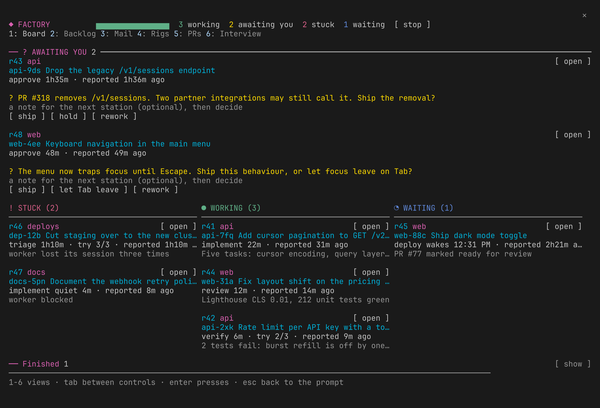
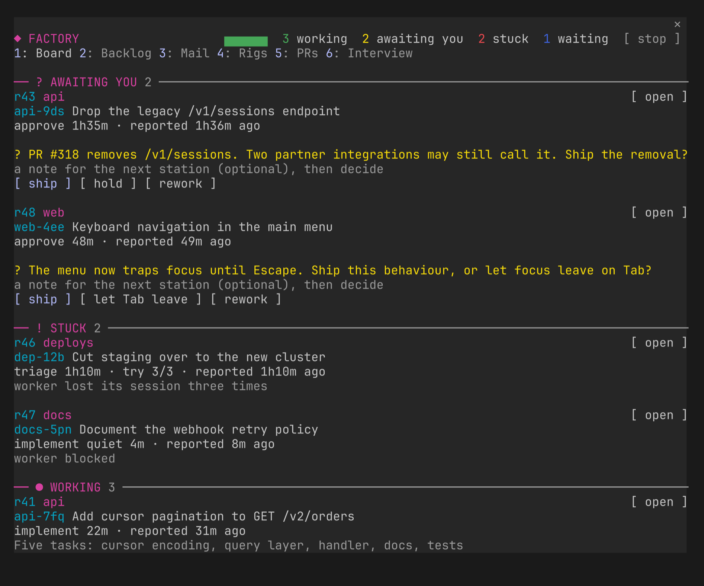
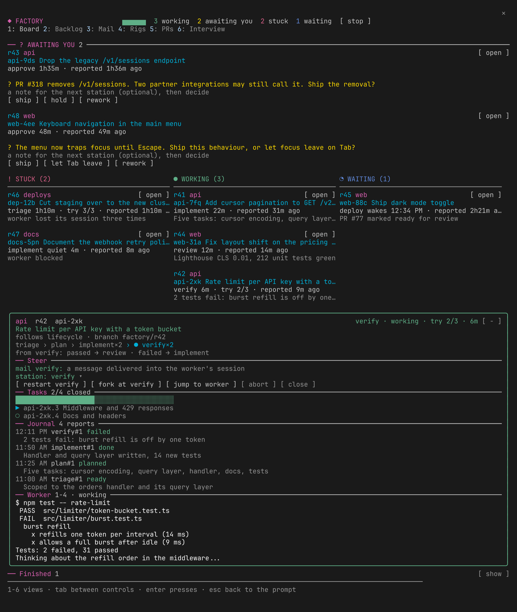
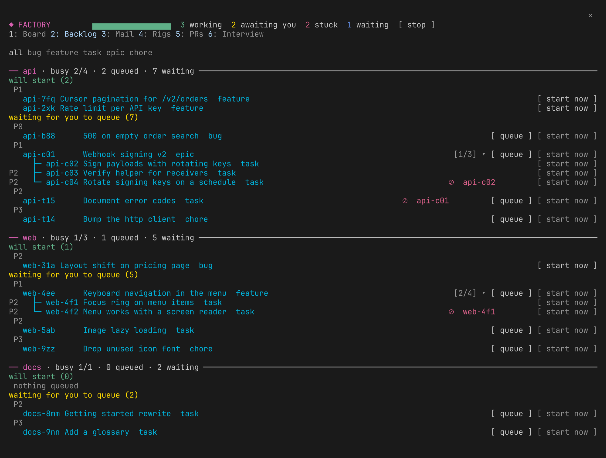
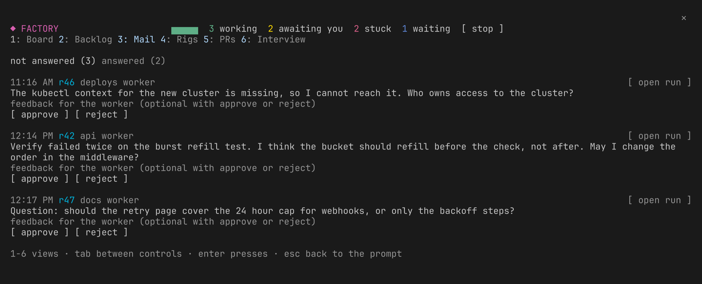
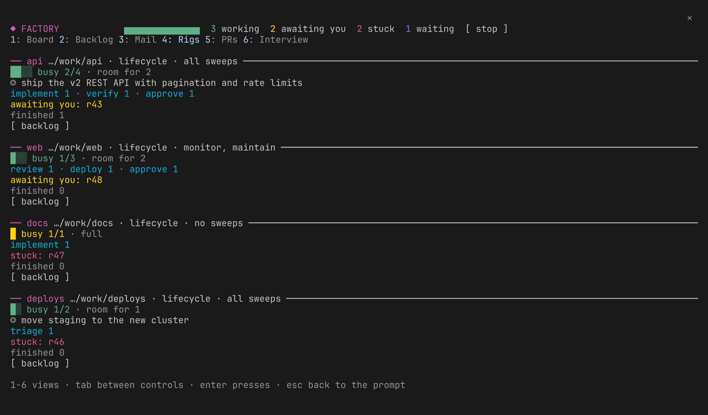
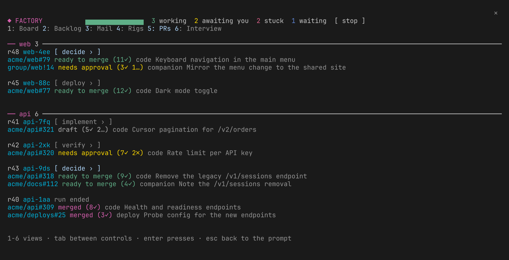
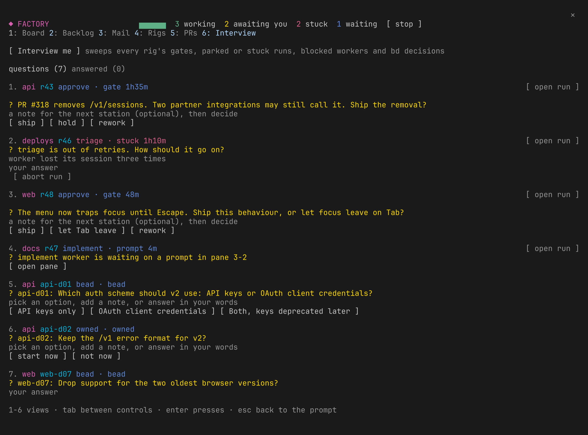

# claude-factory

Software factories for loop-graph engineering on herdr. A factory is a graph of
stations; a run is an xstate machine over that graph whose snapshot is persisted
on every tick. Each station is worked by its own Claude session in a herdr tab of
the run's git worktree, and the outcome it reports routes the run along the graph.
A Claude mod turns one session into the manager: it ticks every run, draws the
board, and runs a hidden patrol subagent that wakes on mail and works each rig's goal.

New to claude-factory? Start with [docs/onboarding.md](docs/onboarding.md).

## Run it

```sh
bun install
bin/factory init ~/my-factory   # a new factory: a directory for its rigs and runs
cd ~/my-factory
# the manager session, in a herdr pane: a session started in a factory's directory works it
# fullscreen layout: the console docks right of the chat (herdr and tmux default to the main screen)
# it runs lean (Bash and file tools, no MCP servers, connectors or Chrome: each call in the main chat
# re-reads every tool definition) and without the herdr-fleet mod, since the runner owns its workers' panes
~/repos/workspaces/claude-factory/bin/factory manager   # add --resume <session> to bring one back
```

Or in one step from a herdr pane: `bin/factory-up [factory-dir] [--resume <session>]` installs deps,
inits the factory (default `$FACTORY_HOME`, else `~/factory`) if new, and starts its manager.

In the manager session:

```
/factory rig add my-app ~/repos/my-app --max 3 --goal ship the v2 API   # a rig: a repo the factory works
/factory start lifecycle my-app Add a /health endpoint with tests
/factory start lifecycle@monitor my-app watch production
/factory start lifecycle@maintain my-app keep it maintained
/factory start lifecycle@improve my-app keep improving it
/factory                      # the board: runs, stations, workers, gates, manager mail
/factory status <run>         # one run's full journal
/factory interview            # questions from runs stuck or parked on your direction; your answer goes to the run
                               # 'Interview me' in the panel also sweeps every rig's gates, bd decisions and blocked
                               # workers in; the manager proposes options for anything still bare, except gates
                               # (only you decide those) and blocked workers (you look at the pane instead)
```

## Console

`/factory` opens the console next to the chat. Keys 1 to 6 switch the tabs: Board, Backlog, Mail,
Rigs, PRs and Interview. Press `tab` to move between controls. Press `enter` to press the
focused control. Press `esc` to go back to the prompt. The pictures show made-up demo data.

See [docs/console.md](docs/console.md) for the details of each tab: what it shows, its
keys and buttons, and when to use it.

### Board (key 1)



The Board shows the live runs by state, oldest first. The runs that await you are in a
full-width band at the top. The stuck, working and waiting runs are in three columns below it.
A gate shows its question and its outcome buttons on its card. Decide the gate there. You can
add a note for the next station.

When the console is less than 120 columns wide, the groups stack as sections:



### Board: an open card



Press `open` on a card to see the run detail. The card shows the full goal, the Steer controls,
the Tasks, the Journal and a peek at the worker pane. Use Steer to mail the worker, to go to a
station, to fork at a station, to retry, to jump to the worker or to abort the run. Press `-` to
shrink the card.

### Backlog (key 2)



The Backlog shows the beads of each rig as a tree. Each rig has one rule. The rule shows the busy
count and the counts of queued and waiting beads. A parent bead shows `[done/total]` for its children.

Press `▸` to show the children. Press `▾` to hide them. The `⛔` mark shows a bead that an open bead
blocks. The mark shows the id of the blocker.

Use the type buttons to filter the beads. Press `queue` to queue a bead. Press `start now` to start
a run on it.

A sweep pass labels each bead that it files with `sweep:<name>`. The Backlog groups these beads
under a `sweep:<name> (n)` heading. The heading is separate from the priority tiers.

### Mail (key 3)



The Mail tab lists the last 50 messages between the manager and the workers. Two sub-tabs divide
the list: not answered and answered. Press `approve` or `reject`, or type feedback and press
`send feedback`, to answer a message. If the run is at a gate, the newest message shows the
outcome buttons of the gate. Press `open run` to see the run on the Board.

### Rigs (key 4)



The Rigs tab shows each rig with a capacity bar, which is its busy count against its cap. It
also shows the sweeps and the goal of the rig, and the number of runs at each station. It shows
which runs await you, which are stuck, and how many are finished or aborted. A rig with a Linear
team ([docs/beads.md#linear](docs/beads.md#linear)) shows its last pull too: pulled count and
age, or an error. Press `backlog` to see only the beads of that rig on the Backlog tab.

When the pm ranks a rig, the Rigs tab shows a line that starts with "Next up". This line
names up to 3 beads, in order, each as `<id> (P<priority>) <why>`. Under it, a yellow line
names each finding: a starved epic, a goal with no open bead, or a gap in the plan.

The pane header and the band show the age of the plan too, for example "plan 12m ago · 2
findings". After 2 hours, both show "plan stale". See
[The manager drives](#the-manager-drives) for what the pm does and how its plan feeds the patrol.

### PRs (key 5)



The PRs tab lists the pull requests and merge requests that each run touches. The tab shows
GitHub pull requests and GitLab merge requests. It groups them by rig and then by run. Each
entry shows the repo and number, the state, the checks, the role and the title. The data comes
from `factory prs` and refreshes not more than one time in 60 seconds. Press the station button, or
`decide ›` for a gate, to open the run on the Board.

### Interview (key 6)



The Interview tab is one list of the questions that only you can answer. It shows these items:

- the gates
- the parked and stuck runs
- the workers that wait on a prompt
- the bd decisions of all rigs

Each item has a short title. The title gives the run or bead id and the decision in plain words. For example: "ama-gs2: will you merge PR #68 now?" Each item also has one line of context and 2-4 options. Each option has a label and an effect.

The manager marks one option "(recommended)" when it has one. The full raw report is behind a `details` toggle. Two items that ask the same decision become one row.

Press `Interview me` to sweep the rigs. After that, the manager proposes a title, context and options for the items that still need them. Press an option or type an answer. Then press `send answer`. The answered items move to the second sub-tab.

## The manager drives

You talk to the manager session. The manager session runs the factory. The main chat is only for
you. The main chat never carries a patrol's own turns. So you can still enter input while a patrol
runs.

When `autopilot` is on (the default), a hidden `patrol` subagent wakes on its own timer, and its
prompt starts with `[factory] patrol`. The patrol wakes at once for new mail, for example a
worker's question, a stuck station, a gate or a finished run. It also wakes at once when a worker
waits at a prompt. It also wakes every 10 minutes while workers run, or while a rig with a
goal has room. A heartbeat wake also needs a change to the board or the rig goals since the last
patrol. Time spent in a station does not count as a change.

A fresh patrol has no memory of the last one. So its prompt always carries the full board, the rig
goals, and the actions of the last few patrols. The actions come from `<home>/patrol-log.jsonl`.

A patrol answers mail and moves stuck runs on with `retry`, `goto`, `fork` or `abort`. It pokes
workers with `factory poke <run> [steer]`. It takes the next work from the backlog when there is
room. It brings owner decisions to you through the Interview tab. It never decides a gate or an
owner-only command, so those stay for you. It ends with a report of at most three lines.

`/factory patrols` lists the last 10 patrols. The pane header and the band show how long ago the
last patrol ran. Underneath, the runtime stays mechanical. It ticks every 5 s, launches and resumes
workers, and nudges an idle worker twice before it retries with backoff. So a quiet manager never
stalls a run.

A hidden `pm` subagent runs once an hour and soon after a run finishes. It reads each rig's ready beads, goal, open epics, epic progress, and runs in flight. It writes `<home>/plan.json`, a ranked list of next work for each rig, with a one-line reason for each bead. It also writes one line per run to `<home>/pm-log.jsonl`. The patrol and `factory dispatch` use this plan when it is less than 2 hours old. If the plan is older or missing, they use today's order instead.

The pm shows two types of problem as decision items. The first type is a starved epic. A starved epic gets no new work for many hours, while lower-priority work is done. The second type is a goal with no open bead. For each problem, the pm makes a human-labeled bead. It is a decision item in the Interview tab, like a proposal.

A plan gap is different. In one kind, an epic stays open after all its children close. In the other kind, a goal has no bead in the plan. For each plan gap, the pm makes an unlabeled bead. A person must add a label to triage it.

The pm does not change the priority of a P0 or P1 bead, a rig goal, or an owner-only setting. It can only propose such a change. The proposal becomes a decision item in the Interview tab. A person must decide on the item. Set `pm` to `false` in the plugin's `userConfig` to turn off the pm.

A manager session can start with no `Agent` tool in its `--tools` list, so each pm spawn fails. The pm checks for the `Agent` tool before it reads any rig's ready beads. If the tool is missing, the pm stops at once. It writes one line to `<home>/pm-log.jsonl` and the Rigs tab shows a red "pm blocked: ..." line. To clear this, exit the factory manager, then run `factory manager --resume <session>`. The patrol and `factory plan show` keep working during the block.

An earlier claude-factory-dun session named the wrong cause for this gap. It rolled the pm's `userConfig` default back to `false`. The default is `true` again now. See CHANGELOG for the corrected cause.

A hidden `briefer` subagent starts once for each gate visit. It has no tool at all.

Run `factory gate-brief facts <run>` first. The command collects these facts:

- The pull request's title, state, diff stat and CI checks.
- The last verify and review (or security) summaries.
- The run's own goal.

The briefer reads that JSON. It writes a brief of 8 lines or fewer. The command
`factory gate-brief set <key> <file>` cleans that brief and keeps it in `<home>/gate-briefs.json`.
It also writes one line per attempt to `<home>/brief-log.jsonl`.

The gate's Interview item then shows the brief. You do not need to read anything first.
The manager's own "Gates" prompt line reads the brief from the `gate.brief` field that
`factory show <run>` shows. It reads the raw pull request and journal only when that field is
missing, or when you ask for more.

A person still decides every gate, with `factory decide`. The briefer cannot run it.
`tool.call` denies it outright. To turn off the briefer, set `briefer` to `false` in the plugin's `userConfig`.

The roles follow [Gas Town](https://github.com/steveyegge/gastown): the manager is the
Mayor (your one point of contact, which hands out the work), station workers are polecats
(a fresh session per visit, a durable identity in the run), each repo the factory works is
a rig, the tick's nudges and session resumes are the Witness, the mod's timer is the daemon,
and mail escalates from worker to manager to you.

## Rigs

A factory is a directory (Gas Town's town): `factory init <dir>` makes one, its
`rigs.json` defines its rigs, and its runs live beside it. Commands, the manager session and
`factory loop` started inside it work that factory; `FACTORY_HOME` overrides, and with
neither the factory is `.factory-state/` here. Run several factories side by side, each with its
own manager.

To keep a factory's config in a repo, make its home one: `git init`, a `.gitignore` that lets in only
the config (`/*`, `!/.gitignore`, `!/rigs.json`), and an `origin`. Every 10 minutes the tick commits
and pushes it, and pushes the memory to the `memory` branch, so the factory can be rebuilt from the repo.

A rig is a repo the factory works, by name. Its ready beads labeled `factory` start as runs,
`factory tick` starts one of its sweeps on each sweep's own cadence (see
[Sweeps](#sweeps)), and it has its own cap on busy runs under the factory's
`FACTORY_MAX_RUNS`. A goal is the person's standing direction for the rig: while the rig has
room, the manager's heartbeat patrol carries it and gives the rig the next work toward it,
using the pm's plan when it is fresh (see [The manager drives](#the-manager-drives)).
The goal also reaches every worker's brief, under "## Rig goal", so a step it reserves for
the person binds every station, not only the manager.

```sh
factory rig add web ~/repos/web --max 4                     # all of factories/sweeps.ts's sweeps
factory rig add app ~/repos/app --max 3 --sweeps none --goal finish the v2 features
factory rig add infra ~/repos/infra lifecycle --max 2 --sweeps monitor --slo "kubectl get pods -n infra | grep -v Running"
factory rig add docs ~/repos/docs review-loop --sweeps none
factory rig                                                 # each rig, its busy runs and sweeps
factory rig rm docs                                         # nothing new starts; its runs carry on
```

A rig's name stands for its repo in every command (`start lifecycle web ...`, `queue web
fx-12`); a repo outside the rigs is given as a path (`./app`, `~/repos/app`). The board tags each run with its rig and the backlog is grouped by rig, with its
room, so the manager fills each rig up to its own cap. Edit `rigs.json` by hand or
redefine a rig with `rig add`; there is one rig per repo.

A rig can name kube contexts that only a person can change. Use `--person-only-context` to
add one. Repeat the flag to add more contexts.

```sh
factory rig add ax ~/repos/ax --person-only-context acme
```

A worker's PreToolUse hook refuses a `kubectl`, `ko` or `helm` command that changes state at a
named context. The hook fails closed. It refuses a command with no `--context` flag, because
the worker does not know its current context. The hook matches context and cluster names only.
It cannot resolve a shell expansion. So it also refuses a `--context` or a kubectl `--cluster`
value that is not a literal name, such as `$CTX` or a backtick.

On every rig, the hook refuses a command longer than 8192 characters. A command this long can
make the hook's own scan too slow. Put a long report summary, bd description or pull request
body in a file under `.scratch/`, and pass it with `--body-file`, or as `"$(cat .scratch/<name>)"`.

On every rig, the hook refuses a command that nests more than 32 `eval` or `sh -c` levels. A
command nested this deep can make the hook's own scan too slow too.

The hook reads only the command text Claude Code is about to run, so it stops a worker that
runs the command directly. It cannot read a script that reaches a shell by another path: a pipe
(`echo "kubectl --context acme apply -f x" | bash`), a here-string, `su -c`, `nix-shell --run`,
or a variable or `$(...)` that holds the real command. The brief's own rule still applies there.
(`env -S`/`env --split-string` is not in this list: the hook reads that value off the command
line itself and checks it the same way it checks an `eval` or `sh -c` argument.)

A rig can name branches that only a person may push, in addition to `main` and `master`.
Use `--protected-branch` to add one branch. Repeat the flag to add more branches.

```sh
factory rig add ax ~/repos/ax --protected-branch acme-deploy
```

A worker's PreToolUse hook denies these commands:

- a `git push` to a protected branch, to `main` or `master`, or to the branch that `origin/HEAD` names
- a `git -c alias.<name>=push` definition: a worker never needs a throwaway push alias
- `gh pr merge`, also with `--auto` and `--admin`
- the GraphQL mutation that turns on a pull request's auto-merge
- a REST or GraphQL call that writes a ref or a file straight to a protected branch (a `git/refs`
  update or delete, a `contents` write with no `branch` field or a protected one, and the
  `createCommitOnBranch`, `updateRef`, `updateRefs` and `deleteRef` GraphQL mutations)
- `gh pr ready`, except in the release station (ship's `release`)
- a `HEAD` push in the same command as a branch change. The push can use one of these forms:
  - a bare `git push`
  - `git push <remote> HEAD`
  - `git push <remote> @`

  A branch change is one of these commands:
  - `git checkout`
  - `git switch`
  - `git branch -m`/`-M`
  - a `git symbolic-ref` write
  - `git rebase` with an explicit `<branch>` operand
  - `git rebase --root <branch>`, or `--root` shortened to 3 or more characters (for example
    `--roo` or `--ro`)
  - `git stash branch <name>`
  - `git bisect reset <commit>`
  - `git update-ref --stdin`, or `--stdin` shortened to 3 or more characters (for example
    `--stdi` or `--st`)
  - `gh pr checkout`

  Run the branch change and the push as 2 separate commands.

- a `HEAD` push in the same command as a direct write to a git administrative path. This write
  uses no `git` word at all (claude-factory-9zd5). The write is one of these:
  - a write to `.git`, to `.git/HEAD`, to a linked worktree's `.git/worktrees/<name>/HEAD`, or
    to `.git/config`
  - a redirect target, or any other plain word, named `HEAD`, in a segment whose own command
    is not `git`, a dashed `git-<verb>` binary, or `gh` (for example, `echo HEAD`, a `dd`, `mv`
    or `ln` operand, or a bare `*` after `git push o HEAD`)
  - the same, named by a glob that matches `HEAD`
  - a `--git-dir`, `--absolute-git-dir`, `--git-path` or `--git-common-dir` flag
  - a `GIT_DIR` or `GIT_COMMON_DIR` name

  The hook also denies a lone `HEAD` push when the worker's own cwd already sits inside a
  directory whose name ends in `.git`.

  Run the write and the push as 2 separate commands.

The hook also denies an equivalent, disguised form of each command above:

- a `gh api` call whose endpoint is `/graphql` or a full `https://.../graphql` URL, not only
  the bare word `graphql`
- a `gh api` field pair in any pflag form (`-f name=value`, `--field=name=value`,
  `-fname=value`, `-f=name=value`), and a clustered short flag such as `-iXPUT` or `-if`
- a `$name` or a `` `cmd` `` shell expansion inside a `gh api` field value or path segment:
  the hook cannot read the shell's own expansion, so it denies the command instead
- a `git push` refspec of `@` or `head` (any letter case), or with a `heads/<branch>` prefix:
  these name the same branch as `HEAD` or `refs/heads/<branch>`
- `git -c remote.<name>.push=<value>` or `git config remote.<name>.push <value>`: either one
  can send a later, plain `git push` to a protected branch with no refspec of its own
- `gh alias set <name> "<expansion>"` and `gh alias import <file>`: the hook denies every one
  of these calls (see the round-3 bullet below), not only a call whose own expansion text
  contains a denied command

A round-3 review found 5 more disguised forms. The hook now denies these too:

- a `gh api graphql --input <file>` call whose JSON body names a mutation through a
  backslash-u escape, for example `merge\u0050ullRequest` for `mergePullRequest`. The hook
  parses the body as JSON and reads its own `query` string, not the raw file text. A body
  that is not correct JSON makes the hook deny the command.
- a `#fragment` on a `gh api` endpoint, for example `pulls/5/merge#x` or `graphql#x`. The hook
  removes the `#fragment` first, then the `?query` and a trailing `/`. Only then does it read the endpoint.
- a `git/refs/heads/<branch>` path where the branch name has a slash, for example
  `acme/deploy`, or is percent-encoded. The hook also denies the singular `git/ref/heads/` path
  and a `contents` write whose `branch` field has a `refs/heads/` or `heads/` prefix.
- every `gh alias set` and `gh alias import` call, not only a call whose own expansion text
  contains a denied command. The text scan misses a denied command in these cases:
  - a `!shell` expansion
  - a `-` stdin expansion
  - a later call that adds more words to the new alias name
- a `git -c alias.<name>=<value>` or `git config alias.<name> <value>` write with any value,
  not only a literal `push` value. A `!shell` value runs too, such as `!git push`.
  The hook also denies a `push.default` value of `upstream` or `tracking`.
  The hook denies git 2.46's `git config set <name> <value>` subcommand form, for every one of these checks and the existing `remote.*.push` check.

A round-4 review found 1 more disguised form. The hook now denies this too:

- a percent-encoded slash in a `gh api` path, for example `git/refs/heads%2Fmain`. GitHub reads
  this as the same branch that `heads/main` names. The hook now decodes the whole path once,
  before it reads any REST pattern. A raw-text match against the still-encoded path missed
  this match outright. A bad encoding denies the command, the rule the branch-name check
  already used.

Security's first review round found 5 more disguised forms. The hook now denies these too:

- `git -c push.default=matching`, `git config push.default matching`, or any other
  `push.default` value the hook does not know. Real git confirmed `matching` sends every local
  branch to a remote branch of the same name, with no refspec on that later command line. Only
  `current`, `simple` and `nothing` stay allowed; every other value fails closed.
- a bare `:` refspec, for example `git push origin :`. Real git confirmed it pushes every
  matching branch, the same broad reach as `--all`.
- `xargs` right before a `git` or `gh` word, for example `echo main | xargs git push origin`.
  `xargs` can read its own operand from stdin, a push refspec or a `gh` verb, after the text
  already on the command line. The hook cannot read that operand before `xargs` does.
- `git --config-env=<name>=<envvar>`, the same `alias.*`, `remote.*.push` and `push.default`
  check `-c <name>=<value>` already runs. The hook can read `<name>`, but not the text of the
  environment variable `<envvar>` names, so it denies the write outright.
- `git send-pack`, the plumbing command that `git push` calls. It has no `push` word on its own
  command line. So the hook now checks its refspecs as it checks `git push`'s.

A review after the first security review found 3 forms similar to those 5. Each earlier change
closed one exact form. Real git moved `main` through a similar form anyway. The hook also denies
these forms:

- an `xargs` value flag with its value as a separate word (`xargs -n 1 git push origin`).

  Or a wrapper between `xargs` and `git` or `gh` (`xargs env git push origin`, `xargs sudo ...`,
  `xargs timeout 5 ...`).

  The hook does not parse the flags of `xargs`. It denies the command when a `git` or `gh` word
  comes after `xargs` in the same segment.

- `git send-pack` with no ref at all. Real git confirmed that it pushes every local branch to a
  remote branch with the same name. It does not push `HEAD` alone, and it has the same broad effect
  as `push.default=matching`. The hook also denies `--stdin` (refs read from the command's own stdin)
  and `--mirror` (the same broad effect as `--all`, with deletes) outright.
- a unique abbreviation of a `git push` or `git send-pack` long flag (claude-factory-ctae). Git's
  own `parse-options` code accepts the prefix in place of the full name. It reaches the same
  flag. The hook denies each abbreviation the same as the full flag name. This covers:
  - the push flags `--all`, `--branches`, `--mirror` and `--prune`
  - the push value flags `--repo`, `--push-option`, `--receive-pack`, `--exec` and
    `--recurse-submodules`
  - the send-pack value flags `--receive-pack`, `--exec`, `--push-option` and `--remote`
  - the send-pack flag `--stdin`

  An abbreviated value flag still takes the next word as its value, the same as the full name.
  The hook denies the whole call instead of a guess. A `--no-dry-run` word, or an abbreviation of
  it, clears an earlier `-n`/`--dry-run` flag on the same command line, in either order. The hook
  then checks the push as normal.

  `git push -o <value>` is also a value flag. A short-flag cluster that holds the letter `o`,
  for example `-uo` or `-fo`, takes the next word as that same value. The hook denies the whole
  call, the same as it denies an abbreviated long value flag.

  The hook checks this value-flag risk before it checks for a dry run.

  A word right after one of these flags can look like `-n` or `--dry-run`.
  That word is really the flag's own value. It is not a dry-run flag.

  Real git 2.54 confirms the risk. `git push --rep -n origin main` moves `main`.
  `git push -uo -n origin` also moves `main`. The hook now denies both.

  A true dry-run flag, with no value flag in front of it, still allows the push.
  One example is `git push -n --mirror o`.

  `sendPackDenied` and the HEAD-push risk check share one parser for the arguments of a
  `git send-pack` call.
  Before this fix, each one had its own, separate scan.
  One scan can miss a `--no-dry-run` word.
  One scan can also miss a value-flag value word that the other scan reads correctly.
  The 2 scans now agree.

- `git -c remote.<name>.mirror=<value>` or `git config remote.<name>.mirror <value>`. Each one
  makes a later, plain push to that remote act like `--mirror`.

- `include.path` and `includeIf.<cond>.path`. Each one loads another config file that the hook
  cannot read. That file can set any key that the hook denies.

- a command that sets `GIT_CONFIG_COUNT`, `GIT_CONFIG_KEY_*`, `GIT_CONFIG_VALUE_*`,
  `GIT_CONFIG_PARAMETERS`, `GIT_CONFIG`, `GIT_CONFIG_GLOBAL` or `GIT_CONFIG_SYSTEM` (a plain
  assignment or an `export`). The hook denies it when a `git` word appears anywhere in the same
  command text, even on a later, `;`-separated line.

  These environment variables replace git's own config lookup outright. No value stays on the
  command line for the hook to check.

A later review found 6 more disguised forms. The hook now denies these too:

- `env -S '<command>'` or `env --split-string='<command>'` has the same risk as `eval`.
  BSD and GNU `env` split `<command>` into words.
  BSD and GNU `env` then run the words as a command.
  The rule also covers the short flag cluster `-vS`.
  The rule also covers the attached form `-S'<command>'`.
  The hook checks the value the same way it checks an `eval` or `sh -c` argument.

- An `env -S` or `--split-string` value can hold a backslash.
  One example is `env -S 'git\_push acme/widget main'`.
  BSD and GNU `env` read `\_` or a newline character as a break between words.
  BSD and GNU `env` read `\t` as a tab inside one word.
  A different backslash use stops `env`, with exit status 1.
  The hook's own check does not break a value such as `git\_push\_origin\_main` at a
  backslash, so it denies the whole value.

- An `env -S` or `--split-string` value can hold a dollar sign.
  One example is `env -S 'git ${FOO} origin main'`.
  `env` changes a `${NAME}` word into one command word when it runs.
  A check on the typed text alone misses the real, changed command.
  The hook denies any dollar sign in such a value for this reason.

- An unquoted `$'...'` or `$"..."` quote hides the real words.
  One example is `bash -c $'git\x20push origin main'`.
  `bash` and `zsh` decode this quote, and they decode it in different ways.
  The hook cannot read the real words, so it denies any such quote outside other quotes.
  This also denies harmless uses such as `echo $'a\tb'`.
  Write the words plainly, or use `printf` or a file (claude-factory-hewq).

- A dash can hide a git-core binary name.
  Two examples are `git-push` and `git-send-pack`.
  A shell finds this name on `PATH` or under `git --exec-path`.
  The shell runs the same code as `git push` or `git send-pack`.
  No `git` word is in the command line.
  The hook reads a `git-<verb>` name as `git <verb>`.

- A command can start with `nice -n 5`, `command -p` or `stdbuf -o0`.
  This command can then run `git push`.
  This command can also set a `GIT_CONFIG_*` environment variable.
  This combination can sit inside an `eval` or `bash -c` argument.
  This combination can sit next to a separate `export` statement.
  The hook reads a `git` word anywhere in the full command text.

- A command can set `HOME=<dir>` or `XDG_CONFIG_HOME=<dir>` next to a `git` word.
  Git reads `$HOME/.gitconfig` as its own global config.
  Git reads `$XDG_CONFIG_HOME/git/config` the same way.
  Each one has the same risk as `GIT_CONFIG_GLOBAL`, a file the hook cannot read.
  `GIT_DIR=<dir>` and `GIT_COMMON_DIR=<dir>` point git at a different repository.
  The hook denies that repository's config file the same way.

- a `cd`, `pushd`, `popd` or `chdir` word before `git push` or `git send-pack`, in this
  segment or an earlier one. Each one can move the push to another repository.
- zsh's own `chdir` builtin, which does the same job as `cd`.
- an `env -C` flag, an `env --chdir` flag, or a `git --git-dir` flag. Each one moves the
  command that it wraps, the same way as `cd`.
- a unique prefix of a long flag name, such as `--ch` or `--chd` for `--chdir`. GNU
  `getopt_long` accepts the prefix in place of the full name. It moves the command in the same
  way.
- a `-C`/`--chdir` flag hidden in an `env -S`/`env --split-string` value. GNU and BSD `env`
  both parse that value again, as more of the `env` flags, when the command runs. For example,
  `env -S '-C /other' git push origin HEAD`.
- an `env -S` or `env --split-string` flag in any form, whether or not it hides a
  `-C`/`--chdir` flag. The hook denies every form.
  - GNU and BSD `env` add the command-line words after the value to its split words.
  - They parse the whole list as one.
  - The hook cannot check that result.

Each of these moves the push to a directory where the hook cannot read the branch. So the hook
denies a push that names `HEAD` or `@`, with a distinct reason (`PUSH_DIR_REASON`) that tells the
worker to name the branch directly, not to retry the same command. The hook allows a push to an
explicit branch that it does not protect.

- a value flag placed before `-C`/`--chdir` or `-S`/`--split-string`.
- This includes `-a`/`--argv0`. That flag sets the zeroth argument of the command that `env`
  runs.
- a short-flag cluster whose last letter is a value flag, such as `-iu`, `-va` or `-0u`. Each
  one takes the next word as its own value, not as the command of `env`. For example,
  `env -iu FOO -C /other git push origin HEAD`.
- a unique prefix of those long flag names, such as `--u` or `--uns` for `--unset`, or `--arg`
  for `--argv0`, which moves or hides the command.
- a long flag name that this hook does not know, or a prefix that names more than one known
  flag. The hook cannot tell these apart from a flag that moves or hides the command, so it
  denies the push.

The `env -S` fix above has a related gap. The hook still did not see `-S`. A value word of an
`env` flag stood in front of it. The hook now denies these forms too:

- `env -u NAME`/`--unset NAME`, `-C DIR`/`--chdir DIR`, `-P PATH` (BSD), or `-a ARG`/
  `--argv0 ARG` (GNU), each followed by `-S '<command>'`. The old scan stopped at the value
  word of the flag (`NAME`, `DIR`, `PATH`, `ARG`). It read that word as the command of `env`.
  It never reached a later `-S`. The hook now reads past that value word. The word can be
  attached to the flag or be the next word. So the hook still finds `-S`.
- a short cluster that ends in one of these flags, for example `-iu FOO`. The hook skips one
  value word in the same way.
- an abbreviated long option name, for example `--spl '<command>'` or `--sp='<command>'`. GNU
  `getopt_long` accepts any prefix of a long option name that names only one option. The
  prefix works the same as `--unset` or `--split-string` in full.

The hook reads `origin/HEAD` live, with a 2 s cap, and it reads the current branch live in
the directory where the push runs. That directory is the tool call's own cwd (`input.cwd`), not
the worktree root, because a prior Bash call's `cd` can leave the two apart. If the push's own
command line has a `-C <path>` flag, the hook applies it to that cwd, in the order the command
gives it. An absolute path replaces the directory, and a relative path joins onto it. When the
tool call has no cwd of its own, the hook uses the worktree root as the directory.

`-c`, `--git-dir`, `--work-tree` and `--namespace` also each take one value word. The hook
skips that value word. The hook does not read that value word as a `-C` flag. A flag that
the hook does not know can also take a value word.
When that value word starts with a dash, the hook cannot tell it apart from a `-C` flag.
The hook then denies the push, with the same `PUSH_DIR_REASON`.

A flag that the hook does not know can also take a value word that reads `push` or `send-pack`.
The hook does not use that word as the verb by itself. As an alternative, the hook looks for
the `push` or `send-pack` word anywhere in the command. When the arguments of that word hold a
literal `-C` word, the hook cannot tell which one applies. The `-C` word can be a missed flag,
or a plain `-C` word in a refspec. The hook then denies the push too, with the same
`PUSH_DIR_REASON`.

If either read is not successful, the hook denies the push outright. A read is not successful
when it has a timeout, a detached `HEAD`, or no `origin` remote. The hook then has no branch
name, or no `origin/HEAD` name, to check.

This rule applies whatever the list holds. Only a person can merge a pull request or push the default branch. A worker pushes its own run branch and opens a pull request.

A worker's brief carries this rule too, in the Rig goal section. The worker reports blocked
with the exact command, instead of running it. The guard does not cover a person's own
session or the manager's session. A person runs the live change.

`--linear <team id[,team id]>` opts a rig into the Linear pull loop. Every 20 minutes the
factory pulls that team's Linear issues into the rig's beads. The loop then strips the
`factory` label back off each pulled bead ([docs/beads.md#linear](docs/beads.md#linear)).

### Harnesses and MCP servers

A station's worker is a shell command (`agent` on the station, or on the factory). Claude Code,
Codex and pi all work: herdr tracks each one's status and session, and the runner spells the
launch, the resume and the MCP config the way that harness expects. `--agent` runs every station
of a rig with one command, and `--mcp` gives its workers the servers in a Claude-shaped
`{ "mcpServers": { ... } }` file: `--mcp-config` for Claude, `-c mcp_servers.<name>=…` for Codex.
pi has no MCP client, so its pane says that the file was not loaded.

`--runner` says where a rig's workers run: `herdr` panes on this machine (the default), or `ax`, an
AX microVM on a cluster ([docs/remote-runner.md](docs/remote-runner.md)). A VM runs the rig's agent
(claude, codex or pi) headless; `--egress host[,host]...[=KEY[:Header:Prefix]]` (repeatable) lets it
reach more hosts, with agent-vault's credential `KEY` injected for them. Runners are an interface
(`src/runner.ts`): a new one is a module and a registry entry.

A factory's `params` are what its worker commands name as `{name}`: lifecycle's are `claude` (the
Claude Code launcher, default `claude-smart --new --no-channels`), `exec_model`, `judge_model` and
`security_model`. A rig sets one with `--param name=value`; otherwise the factory's environment
can, as `FACTORY_<NAME>` (e.g. `FACTORY_CLAUDE=claude factory loop`); otherwise the default holds.
The default worker and the dream start from `FACTORY_CLAUDE` too, and its executable is treated
as Claude.

```sh
factory rig add web ~/repos/web --agent "codex --dangerously-bypass-approvals-and-sandbox"
factory rig add api ~/repos/api --agent "pi --model anthropic/claude-sonnet-5" --sweeps none
factory rig add infra ~/repos/infra --mcp ~/.config/factory/infra-mcp.json
factory rig add docs ~/repos/docs --param exec_model=claude-haiku-4-5-20251001 --param claude=claude
factory rig add svc ~/repos/svc --runner ax --agent "codex -m gpt-5-codex" --egress api.openai.com=OPENAI
```

## The lifecycle factory

[`factories/lifecycle.ts`](factories/lifecycle.ts) is the whole software lifecycle in one graph:

| Loop                          | Stations                                                                                           |
| ----------------------------- | -------------------------------------------------------------------------------------------------- |
| build                         | triage → plan → implement ⇄ verify ⇄ review (→ security) → **hand off to ship**                    |
| small (docs, test-only, tiny) | triage → quick ⇄ check (→ security only when flagged) → **hand off to ship**                       |
| optimize (performance, cost)  | baseline → plan → implement ⇄ verify against the target → … → hand off to ship; abandon when disproved |
| refactor                      | characterize (pin behavior) → plan → implement ⇄ verify → … → hand off to ship                     |
| incident                      | incident → rollback or plan → … → hand off to ship                                                 |
| ship (one run for each rig)   | queue → release → deploy (**you merge**) → soak → queue …; rollback → postmortem when it fails    |

The lifecycle factory has no sweep stations. For the monitor, maintain and improve sweeps, see [Sweeps](#sweeps).

**Ship owns the release.** When review, security or check approves, the work run ends on a `ship` edge. The runner leaves the bead open, takes off the `factory` label and adds the label `ship` and the metadata `ship_at`, `ship_run`, `ship_branch` and `ship_pr`. The work run then holds no run slot. [`factories/ship.ts`](factories/ship.ts) is one run for each rig, started by the runner when the rig has a queued bead. It does not count against `FACTORY_MAX_RUNS` or the rig's `--max`: those limits count work runs only. A second ship run on the same rig is refused. `factory ship <rig>` prints the queue, oldest handoff first, with the next PR to merge marked. `factory status` and `factory waiting` show each rig's queue, and `waiting` lists all owner-only steps (`parked, waiting on:`) in one group.

Ship works the queue in order. At `queue` it merges `origin/main` into the next PR with a merge commit. It never rebases and never force-pushes. At `release` it marks only that PR ready. At `deploy` it waits for your merge.

**Your merge is the gate.** Deploy waits for your merge on GitHub. After your merge, deploy starts and monitors the rollout. Deploy does not merge the pull request. No ship station merges.

If a queued PR needs changes (a conflict ship cannot resolve, a red check, a change request, a failed deploy), ship adds the evidence to the bead and labels it `factory` and `station:implement`. Dispatch starts a new run at implement, with the worktree on `origin/<ship_branch>`. That run pushes to the same branch and hands off again when it is approved. A `conflict` or `rework` label on a queued PR goes to the ship run, not to a rework run. If you close the pull request, ship reports `hold` and the bead returns to the queue.

**Runs that started before this change** finish on the old path. Each run pins its own `factory.json`, so a parked deploy or soak run keeps its release, deploy and soak stations. No code moves them. A rig with its own `.factory/lifecycle.ts` keeps its own release and deploy until it adopts this change.

Sonnet does the implement work. Opus does the plan work and the review work. Fable does the security review.

Triage selects `small` for a change that is docs-only, test-only, or tiny. A tiny change has about 50 changed lines or fewer. It changes 3 files or fewer. It has no new dependency, no migration, and no public API change. Triage does not select `small` when the change is security-sensitive or when it changes a factory definition.

The `small` loop skips the Opus plan step. It adds the security station only when `check` flags the change. Ship's deploy reports `published`, with no soak, for a docs-only or test-only change. The same applies to a library or to a change to `.factory/` only. The test `factories/lifecycle.test.ts` walks every loop through the machine.

`bin/factory help` lists every command; the manager model uses the same CLI.

## Sweeps

[`factories/sweeps.ts`](factories/sweeps.ts) holds the standing sweeps, apart from lifecycle:

| Sweep    | Cadence       | What it needs                         |
| -------- | ------------- | -------------------------------------- |
| monitor  | every 30 min  | a rig's `--slo '<read-only command>'` |
| maintain | daily         | nothing extra                          |
| improve  | daily, rotating refactor, performance, cost and factory-health lens | nothing extra |

`factory tick` starts one run per due `(rig, sweep)` pass, at most every `FACTORY_SWEEP_MS`
(default 300000ms); `FACTORY_SWEEPS=0` turns this off. Each pass goes straight to `done`: it
files what it finds as beads, not as a standing run. `rig add --sweeps a,b|none` picks which
sweeps a rig runs; the default is all of them. `monitor` reads the rig's `--slo` command on the
laptop (never on a VM worker), hashes its output, and starts a run only when the hash changed
since the last pass; the unchanged output never reaches a model. Start a pass by hand with
`factory start sweeps@maintain <rig> 'sweep: maintain'`.

**Flood guard**: a sweep-filed bead carries the label `sweep:<name>` (for example
`sweep:maintain`). Each rig keeps at most 5 such beads in any 24-hour window. A later bead
that day still gets filed, but it waits for a person instead of starting on its own. A kept
bead keeps the `factory` label, and starts on its own, only when it also carries
`sweep-queue:incident`, `sweep-queue:main-ci-red` or `sweep-queue:critical-advisory`. Every
other kept bead loses the `factory` label too and waits for a person, the same as a later
bead. The [Backlog tab](#backlog-key-2) groups beads by their `sweep:<name>` label.

A pinned run from before this design (`claude-factory-8pc`) still loads its own copy of the
sweep stations from `factories/lifecycle.ts`, if its `factory.json` holds one.

## The factory improves itself

`factory adopt <repo>` copies the lifecycle template into `<repo>/.factory/lifecycle.ts`;
commit it, and the repo owns its factory like any other code:

- **Runs pin their factory.** `start lifecycle` (and a rig's dispatch) use the repo's own
  `.factory/lifecycle.ts` as of the commit the run starts from, copied into the run, so no
  later edit, the run's own included, changes the graph under it. Without a repo copy, the
  template in `factories/` is used. `factory status <run>` says which version a run follows.
- **New runs start from what has merged.** A run branches from the remote's default branch,
  freshly fetched, whenever that already holds your local HEAD; from local HEAD when you have
  unpushed work. So a merged factory change reaches the next run with nothing to pull.
- **The improve sweep's fourth lens is the factory itself**: it reads recent runs' journals
  and the closed factory beads' comments (retries, stuck stations, loops, gates always
  answered the same way, costly models) and files one change to `.factory/` per finding.
  Postmortems file the factory changes an incident exposed.
- **Those changes ship like any change**: plan, implement, `factory check` in verify, a review
  that reads them as policy (security review when they remove a gate, widen what runs
  unattended or raise a limit), and your merge. Deploy reports them as published.
- `factory check <file>` validates a factory: the graph, its outcomes and timed edges, and a
  way to `done` from every station. A factory whose starting commit does not validate is
  refused before any worker starts, and its bead is deferred with the reason.

## Shared memory and the dream

A factory's workers share what they learn in `<factory>/memory/`, in tiers so a brief stays
short and a search finds the rest:

```
memory/
  CORE.md              fact/behavior tier: the few lessons nearly every run needs, every brief carries it whole
  <topic>/README.md    what the topic covers, its notes most important first: briefs list topics
  <topic>/LONG.md      long tier: lessons merged from several short notes, one `## ` heading each
  <topic>/<note>.md    short tier: one worker's learning (summary, rig, from, at, body): found by search
  inbox/<note>.md      new notes, until the dream files them
  .archive/<topic>.md  notes a tiering pass dropped: stale, never helped, or marked superseded
```

- Workers search before they start and save what a later worker would otherwise relearn:
  `factory memory search [--rig r] <query>` (local embeddings, bge-small, no service; a note
  ranks by its own match and its topic's, a long or fact note ranks slightly above a short one
  on a near-tie, and another rig's notes never show) and
  `factory memory add [--rig r] [--from run/station] <summary> [body]`. The manager searches
  it before answering a worker and saves the person's decisions that later runs should follow.
  `factory memory helped [--from run/station] <note>` marks a note that saved a worker time;
  with how often searches return each note, it is what the dream orders by.
- **The dream** (`factory dream`; each tick starts one a day) is a headless Claude that can only
  edit inside the memory: it files the inbox under topics, merges duplicates, drops what is
  wrong or stale, writes lessons from the run journals since the last dream, and reorders the
  READMEs and `CORE.md` by importance. It also sees three lists the memory computes for it:
  promotion candidates (a `LONG.md` entry several runs found helpful several times, for the dream
  to write as a `CORE.md` line), possible duplicates (two `LONG.md` entries that score as the
  same lesson, for the dream to merge), and unsafe `LONG.md` files (one with text before its first
  entry that a merge would lose, for the dream to fix by hand; until then, the tiering pass skips
  a merge into that topic). A lesson that holds only while a bead is open names it;
  the dream is told which named beads have closed and retires what waited on them. The memory is its own git repo, committed before and
  after each dream: `git -C <factory>/memory log -p` shows what a dream did, and a revert undoes it.
  Each commit also carries that step's `.usage.jsonl` (per-note counts) and `.renames.jsonl`
  (old path to new path). compact() writes both files before the commit. The repo stays clean right after.
- **The tiering pass** (`factory memory compact [--dry-run]`) runs right after the dream, unless
  `FACTORY_MEMORY_TIERS=0`. It is deterministic, not an LLM: it merges a short note into its
  topic's `LONG.md` once the note is 7 days old and was shown or helped at least once, and
  archives a short note into `.archive/<topic>.md` once it is 30 days unused and never helped, or
  once it was never shown at all and is 14 days old (or marked `superseded:` outright). Both
  usage-based archive rules wait until the store holds at least 14 days of usage history, so a new
  or lost `.usage.jsonl` cannot be misread as "never shown." A pass archives at most
  `FACTORY_MEMORY_ARCHIVE_CAP` notes (default 25), oldest first across every topic; the rest are
  held back for a later pass. The pass writes its plan to `dream.log` before it merges or archives
  anything. A merge keeps the note's usage count under its new `<topic>/LONG.md#<id>` path,
  through `.renames.jsonl`, so a later `factory memory helped <old path>` still resolves and
  nothing helped is lost. `--dry-run` prints the plan without writing.
- `factory memory eval` runs a fixed query set (`<memory>/.eval.jsonl`) through search and prints
  recall@5 and MRR, with which queries missed: how to tell that tiering did not cost search quality.

## Pull request labels

Every 2 minutes the factory checks each rig's open pull requests for the labels
pr-merger's review buttons put on them, which only label and leave the
acting to a later bot:

A PR belongs to a live run when its branch is the run's (`factory/<run>`) or the run's reports link it.

- **`close`**: the factory closes the PR with a comment, and aborts the run it belongs to, which
  defers its bead.
- **`conflict`**: when the rig has room, a [rework](factories/rework.yaml) run merges the base into the
  PR's branch, resolves the conflicts, runs the tests and pushes; the label comes off and a comment names
  the run. A worker that can't tell how to resolve one says so on the PR. A PR from a fork shows as
  the rig's error instead, since its branch is not ours to push.
- **`rework`**: the same run, for a PR that needs changes: it reads the PR's reviews, comments and
  checks, makes the changes asked for, tests and pushes. A PR with both labels gets one run for both.

A `conflict` or `rework` PR that belongs to a live run goes to that run instead: its current station
is mailed what the label asks (a parked one wakes), so two workers never push to one branch.

The rework run triages first: a PR that is no longer wanted (already on the base, superseded, or
rejected in review) gets a comment and the `close` label, and the next pass closes it.

## Beads: planning and execution

In a repo with `.beads/`, beads is the factory's task tracker. [docs/beads.md](docs/beads.md) is the guide: making a rig, queueing work, epics, claims, sharing across machines and common problems.

- **Every run works a bead**, its epic. `start` claims the bead its goal names
  (`/factory start lifecycle ~/repos/my-app fx-12`) or creates one from the goal.
- **Planning**: the plan station records its tasks as the bead's children, in dependency
  order. **Execution**: implement works `bd ready --parent <bead>` and closes each task with
  its commit; verify, review and security file their findings as more tasks; release
  refuses while any task is open.
- **The journal mirrors into the bead**: every station's report becomes a comment (a
  sweep's routine passes excepted), and workers' bd writes carry `factory/<run>/<station>`.
- **The end of a run settles its bead**: shipped or otherwise finished closes it; a hold or an
  abort defers it, unassigned (undefer it to hand it back); a reject leaves it open and ready but
  out of the queue, swapping the `factory` label for `rejected` and recording `rejected_by`,
  `rejected_at` and `reject_reason` in its metadata (queue it again, or close it yourself); with
  open child beads, however the run ended, it stays open and unassigned for them; an edge with
  `requeue: true` (see below) leaves the bead open, ready and `factory`-labeled instead. The next
  dispatch starts a new run on it, in the factory and station its labels name.
- **The backlog dispatches itself**: every rig's ready, unassigned, top-level beads labeled
  `factory` become runs, every 30 s while the rig and the town have room. A
  `station:<name>` label starts one at that station. A `factory:<name>` label compiles that
  factory instead of the rig's own, so a run can hand a bead to another factory with no hand
  start (for example, lifecycle to release). Dispatch reads both labels together. A bad label
  defers that one bead, never the rest of the rig: two `factory:` or two `station:` labels on one
  bead, an unknown factory name ('no factory \<name\>'), a factory file that fails to load, or a
  `station:<name>` the named factory lacks. Neither label is read from a Linear-sourced bead; a
  requeue edge on one defers instead of looping.
- **Dispatch checks a bead before it starts a run**: it looks for a merged pull request that
  already names the bead's id. It also looks for a live run that already holds the bead. On a
  hit, it rejects the bead (`rejected_by: dispatch`) or leaves one comment, and starts no run.
  `factory queue <rig> <id>` clears the reject and starts the bead. Set `FACTORY_PRECHECK=0`
  to turn the check off. See [docs/beads.md](docs/beads.md#hand-work-to-the-factory) for the
  full rule.
- **Sweeps file to the backlog**: incidents and security fixes labeled `factory` start on
  their own; everything else is filed unlabeled for you to prioritize by adding the label.
- **Sync**: every 5 minutes each rig with a Dolt remote runs `bd sync` (pull, repair, push), so
  beads and claims from other machines reach dispatch and the factory's reach them. It runs in
  its own parallel `factory sync` pass, never inside dispatch, and a failing rig backs off up to
  an hour (`FACTORY_SYNC_TIMEOUT_MS` caps each call). A remote
  nobody has pushed to yet, or a conflict sync won't settle, shows as the rig's error in the
  console; seed a new remote once with `bd dolt push`. The `beads-remote` plugin (below) sets a
  rig's remote up on any git host.
- **Leases**: the run heartbeats its claim every 2 minutes, so a `bd reclaim` reaper never
  takes live work. Without `.beads/`, runs keep task lists in their reports instead.

## Plugins

`plugins/` holds Claude Code plugins that come with the factory, listed in this repo's marketplace:

```sh
/plugin marketplace add <path or git URL of this repo>
/plugin install beads-remote@claude-factory
```

- **beads-remote**: a skill and script that make a repo's beads sync through its git remote on
  any host (GitLab, GitHub, any git), or bring a remote's beads into a fresh clone. What a repo
  needs before `factory rig add` on a new machine.

## Define a factory

`factories/<name>.ts` exports a graph ([review-loop](factories/review-loop.ts)):

```ts
export default {
  name: 'review-loop',
  start: 'implement',
  nodes: {
    implement: { prompt: '...', next: { ready: 'review' } },
    review: { prompt: '...', next: { approve: 'done', changes: 'implement' } },
  },
} satisfies Factory
```

Per station: `retries` (default 2), `timeoutMin` (60), `parkMin` (60), `agent` (worker command),
`rounds` (how many times it may report one outcome in a run before the next such report is held for
the manager; lifecycle's review has 3; only a looping-back outcome counts, so review's `security` and `approve` never do; see `rounds` in src/machine.ts), `onRounds` (a node for a re-plan at the round cap, below),
`repeatMail` (an outcome that mails the manager on a repeat, below), `gate: true` for a station the
person decides instead of a worker, and `awaitsPr: true` for a station that must wait for someone
to merge, close or update a pull or merge request an arrival's report links, before it starts a
worker (lifecycle's `deploy`; see Parking below). An edge can wait: `{ to: 'soak', delayMin: 15 }`
parks the run with no worker; `goto` skips the wait. An edge into `done` can carry `defer: true`
(the bead goes back to a person) or `reject: true` (the bead stays open and ready, out of the
queue, until someone queues it again). It can instead carry `requeue: true`, or
`requeue: { factory?, station? }`. Either way the bead stays open, ready and `factory`-labeled.
The next dispatch starts it in the factory and station the `requeue` object names, or in the
labels the worker already set when `requeue` is `true` (claude-factory-wnm; see "The backlog
dispatches itself" above). A `defer` edge can also name a station: `defer: { station: 'plan' }`.
It defers the bead and swaps its `station:*` label. The run after a `bd undefer` starts at that
station. The station must be a node of the same factory.

Lifecycle's triage has three outcomes that end the run at once (claude-factory-502):

- `rollout`: the goal is to ship pull requests that are already open or merged. The bead requeues
  into the `release` factory.
- `decision`: the work needs a person's choice. The worker puts the question on the bead. The run
  ends deferred. `bd undefer` starts it again at `plan`. Plan and implement also report `decision`.
- `elsewhere`: the work belongs in another rig's repo. The worker files the bead there and
  comments its id on this bead. The run ends deferred. A worker that cannot reach that repo writes
  a `File in:` line, and the manager files the bead.

`onRounds` names the node that takes the first capped report, instead of the manager. The run
carries the round's findings to that node. A second capped report in the same run still goes to
the manager, and the mail names the earlier re-plan. Lifecycle's review sets `onRounds` to `plan`.

`repeatMail` names an outcome in `next`. A station can report this outcome two times in a row.

Each report must name the same `AC<n>` id on its own `Failing: AC2, AC6` line. An id named only as
passing elsewhere in a report does not count.

When both reports share a failing id, the machine mails the manager from `'factory'`. The mail
names the station, the shared ids and both report times.

The run still follows the outcome's normal edge in every case. With no shared failing id, the
machine sends no mail.

A re-plan between the two reports also sends no mail, because a re-plan can renumber the acceptance
criteria.

A re-plan has two cases. In the first case, the capped node's own `onRounds` jump occurs. Its log
entry carries `replan: true`.

In the second case, a manager `goto` reaches a node that another node's `onRounds` names. That node
then reports in between. It has no `replan` entry of its own.

Lifecycle's verify sets `repeatMail` to `red`. Its prompt asks for the `Failing:` line.

`onTimeout: { timeoutMin, prompt? }` gives the attempt right after a timeout fail a longer limit
than the station's own `timeoutMin`, plus an extra brief section carrying `prompt`, instead of the
same limit and a brief with no extra text (lifecycle's `security`: 45 min, then 75 min with a
prompt that works from review's diff summary instead of the whole branch again). A 2nd timeout in
a row still goes to `isRepeatFail`'s stuck state and one manager mail, same as any other repeated
silent failure. `validate` refuses `onTimeout` on a gate, and refuses `onTimeout.timeoutMin` at or
under `timeoutMin`.
Per factory: `agent`, `rules` (house rules in every brief), `backoffSec` (30, doubling),
`maxSteps` (20 worker launches before the run is held for the manager; every timed
edge refills it, so soak's `unsure` self-loop does not run out), `maxContextK` (200: the context, in thousands of
tokens, past which a Claude worker hands off to a fresh one). Edits apply at the next tick.

A factory can also be data: `.json`, `.yaml`/`.yml` or `.toml`, the same shape. And it can
extend another instead of copying it: `extends` names a factory (a path, a file beside it, else a
built-in), its `nodes` add stations or change only the fields they name (`next` outcome by
outcome), `params` merge and `rules` append. Adding a station to lifecycle is a new node and one
rewired outcome, e.g. `.factory/lifecycle.yaml` in a repo (it extends the built-in, not itself):

```yaml
extends: lifecycle
nodes:
  a11y:
    prompt: Check the change's accessibility against WCAG 2.2 AA. Report "pass", or "fix" with what to change.
    next: { pass: security, fix: implement }
  review:
    next: { approve: a11y } # review's other outcomes stay
```

`factory check <file>` validates one. A run pins its factory resolved, so a base changed later
reaches only new runs.

## herdr sidebar

Every tick reports a `$factory` token: on each run's workspace, its station and what holds it
(`deploy · parked`, `approve · needs you`), and on the manager's workspace the rollup
(`5 running · 1 need you · 1 parked`). Show it by adding a Space row to herdr's `config.toml`:

```toml
[ui.sidebar.spaces]
rows = [
  ["state_icon", "workspace"],
  ["branch", "git_status"],
  [{ token = "$factory", rules = [{ contains = "need", fg = "#f38ba8", bold = true }, { contains = "stuck", fg = "#fab387" }, { contains = "parked", fg = "#f9e2af" }] }],
]
```

## How a run behaves

- **Snapshots**: `.factory-state/runs/<run>/state.json` is the run (`FACTORY_HOME` moves it). Every tick restores
  it, drains `inbox.jsonl`, reconciles the worker, and writes it back (fsynced),
  so a crashed or restarted manager picks up where it stopped.
- **Mailboxes and journal**: a station's report summary is mailed to the next
  station, and every brief carries the run's journal of all reports, so a plan or a
  baseline reaches every later station. The manager and workers mail each other
  with `factory mail`; a worker waiting on an answer is not nudged.
- **Gates**: a gate pages the manager with the evidence. Only `factory decide` answers
  it: workers are refused, and the manager model's decide needs your Allow in a dialog.
- **Retries**: a failed report, timeout, closed pane or a worker that goes idle
  without reporting (after two nudges) backs off and retries with a fresh worker.
  Out of retries, the station is stuck and the manager is paged. Stations with
  side effects you never want repeated: `retries: 0`.
- **Parking**: a worker reports `blocked "<what>"` when it waits on something outside the
  run (a person's decision, a human review or merge, another run). The run parks at that
  station. It spends no worker and no attempt. The manager learns what it waits for. A fresh
  worker checks again after `parkMin`, or as soon as someone mails the station. Deploy parks
  this way on a pull request that only a person can approve or merge. When the report links
  pull requests, the factory watches them (`gh` or `glab`, every minute). It mails the station
  once a real change happens after the park: a new head commit, a merge, a close, or a review
  or comment by a person (an owner, member or collaborator, never a bot). A bot comment, a CI
  status or a label changes only `updatedAt` and wakes nothing. Two cases start no worker. If
  every linked pull request closes without a merge and the station has a `hold` outcome, the
  watch routes `hold` and the run ends. If a person asks for changes on an open pull request
  (a CHANGES_REQUESTED review, or a comment that starts with `/changes`) and the station has
  a `changes` outcome, the watch routes `changes`. It mails the comments to the next station
  and files one bd task for each comment under the run's bead. When the 8-hour timer is
  near and every linked pull request is open and unchanged, the watch parks the station again
  for 8 hours and starts no worker. If a `gh` call fails, the timer still starts a worker. When
  no linked pull request stays open (for example, a deploy that waits on CI after the
  merge), the station wakes on the plain `parkMin` timer instead. `watch.json` in the factory
  home lists the `woke`, `routed` and `reparked` runs of the last pass.
- **Parking before a worker ever starts**: a station marked `awaitsPr: true` (lifecycle's
  `deploy`) skips its first worker, too. This happens when the arrival that reaches the
  station already links a pull or merge request (release's report). The run parks there at
  once, the same way a worker's own `blocked` report parks it. It spends no attempt and
  starts no worker. The same `gh`/`glab` watch, polled every minute, wakes it for a real change
  (a merge, a new head commit or a person's comment) and routes a close or a change request. A deploy worker starts only once
  there is work for it to do.
- **Durable workers**: a worker whose pane dies resumes its own Claude session once
  before falling back to a retry; fresh workers are told what the branch already
  committed. Reports carry the worker's `seq`, so stale and duplicate ones drop.
- **Handoff**: every turn re-reads a session's whole context, so a long session costs
  quadratically. Past `maxContextK` the runner asks the worker to commit and report
  `handoff` with notes; a fresh worker at the same station starts from them, spending no
  attempt. One that keeps going to 1.25x the limit is cut off and handed off anyway; its
  uncommitted changes stay in the worktree.
- **Lean workers**: a Claude worker gets its own settings: `--setting-sources project,local` plus a `--settings` file with the user's hooks and env. It also gets a short system prompt ([src/worker-system.md](src/worker-system.md)) and its own tools. MCP tools stay deferred behind ToolSearch, and auto memory is off. The worker skips the user's plugins, agents, skills, global `CLAUDE.md` and connectors, which cost `~40k tokens/turn`. One plugin stays in: `asd-ste100`, if the user has it on, so it writes PR text and reports in ASD-STE100. The repo's own `CLAUDE.md` still applies, and `FACTORY_LEAN=0` restores the user's full setup.
- **Usage limits**: a worker whose turn is refused for the account's usage limit (weekly or
  5-hour) is restarted on the next account: `ccswitch switch-to` moves
  every Claude on the machine to the next account in its sequence whose limit has reset, and
  the worker resumes its session there. With every account at its limit, workers hold (no
  nudges, no timeout) until the first reset, and the manager hears once. `factory manager`
  does the same for the manager: it checks the manager's transcript each minute and, refused,
  swaps the account and resumes the manager's session.
  A worker on the `ax` runner uses the vault's token, which ccswitch does not rotate: it
  holds until its limit resets.
- **Manager skills**: the manager gets the factory's own skills, playbooks for the work it
  keeps repeating, from `memory/.manager/.claude/skills/` (an `--add-dir`, so Claude Code picks
  up edits mid-session). `factory manager` records its sessions, and the dream reads what each
  was asked and ran since the last dream: work done the same way three or more times becomes a
  proposed skill, and a skill unused for 30 days, or one that no longer fits, is proposed for
  reaping. The dream writes proposals to `memory/.manager/skills/` (Claude Code refuses an
  unattended write under `.claude/`), and nothing installs on its own: the next tick mails the
  manager the new, changed and reaped ones, and it reads each and runs `factory skills install
<name>` or `factory skills reject <name> <why>` (the reason goes to the dream's inbox). Skills
  are in the memory's git history like its notes.
- **Tokens**: `factory metrics --tokens` adds what the live runs' workers spent, by station,
  from their Claude transcripts.
- **Quarterbacking**: `decide`, `retry`, `goto <station|done>`, `abort`, `fork <run>
<station> [note]` (try another approach on a copy), `rm` (finished runs; the branch
  stays). `start` and `fork` refuse past `FACTORY_MAX_RUNS` (16) runs holding a worker.
  Three kinds of run cost no slot in this cap: a run parked at a gate; a run that waits on
  a timed edge or a blocked report; a stuck run, held for a person after `FAIL` used up
  its retries. A stuck run still costs a slot in its own rig's `--max`, because its worker
  pane stays up.

## Releasing claude-factory

[docs/releasing.md](docs/releasing.md) has the full recipe. Run the `release` workflow
from the Actions tab. Merge its `release/vX.Y.Z` pull request with
`gh pr merge --match-head-commit`. Then `release-tag.yml` tags the release and publishes
it on its own. The doc also records the tag-signing decision (gitsign, Sigstore's
keyless signer) and names which CI checks run, and which skip, in
`.github/workflows/ci.yml`.

## Caveats

- Workers run `--dangerously-skip-permissions` by default, each in its own
  worktree. Set `agent` to change that.
- Claude trusts a worktree through its main repo. A run on a repo Claude does not trust
  yet starts no worker (it would stop at the folder-trust dialog): the board shows it
  awaiting trust, the manager is paged once, and `rig add` warns. Run `claude` in the
  repo once and accept. (Not for a rig whose runner is `ax`: its VM runs the agent headless.)
- Station prompts are stack-agnostic and defer to the repo's own CLAUDE.md,
  CONTRIBUTING and CI. Deploy, soak, rollback and monitor need the workers to reach
  your deploy tooling and telemetry (kubectl, gh, the Grafana MCP) the way you do.
- The gate guard against workers is an environment check, not a lock: a worker set
  on it could still run `factory decide`. The manager-session dialog is enforced.
- The runner and the workers use whatever `bd` is first on PATH; it must match the
  repo's beads schema. Syncing beads across machines (`bd dolt push`) stays yours.
- One manager session at a time: a second one shares the ticks, and manager
  mail goes to whichever one ticks first.
